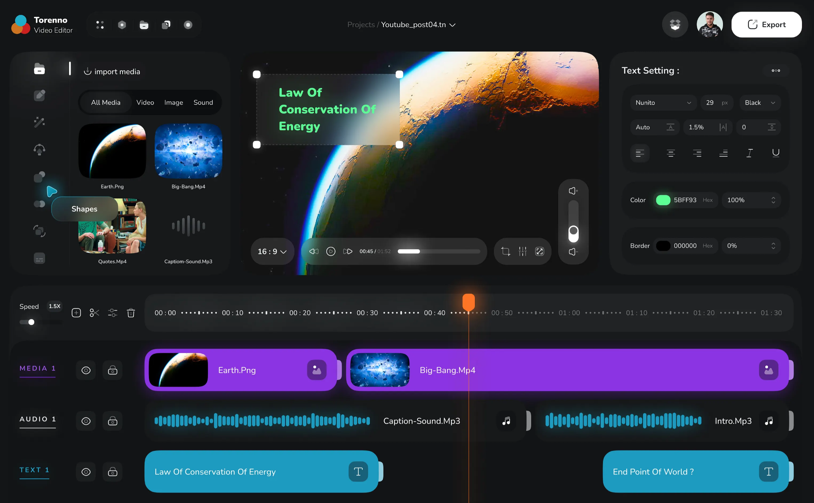

# AI Video Editor — Cahier des charges et instructions pour Codex

> **Statut : spécification de référence pour l'implémentation.**
> Ce document constitue la source de vérité du projet. Il décrit le produit, l'interface, les flux, l'architecture et l'ordre de développement. **Codex doit produire une application fonctionnelle, pas seulement des maquettes ou du pseudo-code.**
>
> **Référence visuelle obligatoire :** `design-reference.png` (capture d’écran originale fournie par le client, à placer **dans le même dossier** que ce document). **Ne pas la remplacer par un design généré, une inspiration trouvée sur Internet ou une maquette générique.** Codex doit ouvrir et examiner l’image avant de coder l’UI ; si le fichier est absent, il doit demander l’image, pas imaginer un autre design.

## 0. Consignes prioritaires à Codex

1. **Stack obligatoire : React + TypeScript + Vite (frontend), Python + FastAPI (backend), MySQL (base de données). Ne pas utiliser Laravel.**
2. **Reproduire fidèlement l’image `design-reference.png`, et non seulement son style** : mêmes proportions, hiérarchie, couleurs, espacements, grands panneaux arrondis, topbar, rail vertical gauche, panneau bibliothèque, preview centrale, inspecteur droit et timeline basse. Les clips violets, titres cyan, waveforms cyan, et playhead orange doivent être visuellement reconnaissables. Recréer l’interface en composants React/CSS réels — **NE PAS utiliser la capture comme fond d’écran de l’application**. Ne pas réutiliser la marque ni le logo visible sur l’image.
3. **L’authentification est obligatoire dès la Phase 1** : inscription, connexion, session sécurisée, déconnexion, récupération/réinitialisation du mot de passe, routes protégées, profil, isolation stricte des données de chaque utilisateur (projets, médias, AI Scripts, réglages/API keys). Aucun mode invité implicite.
4. **Le moteur d’IA de résumé choisit les extraits uniquement à partir du texte transcrit et de ses timestamps. Ne pas développer de reconnaissance visuelle de scènes, ne pas envoyer d'images/frames/vidéos à l'IA.** L'extraction locale de miniatures pour l'interface reste autorisée.
5. **Deux modes d’IA obligatoires :** (a) API automatique Gemini/OpenAI via clé configurée dans les paramètres ; (b) mode manuel : génération d'un prompt complet, copier/coller dans une IA externe puis import/collage d'une réponse JSON. Les deux utilisent le **même contrat JSON validé**.
6. La **bibliothèque d’IA est extensible et personnalisable**. Un utilisateur peut créer un nombre quelconque d'AI Scripts, définir prompts, inputs, variables, paramètres, schéma JSON et actions autorisées. Les AI Scripts sont dans `Bibliothèque > Components > AIs` et sont aussi administrables via **AI Studio**.
7. **Timeline par tracks/layers** avec clips manipulables, hide/show, mute/unmute, lock/unlock, déplacement, trim, split, suppression de clip, suppression de track, ordre des tracks, undo/redo, zoom et snapping.
8. **Effects, Transitions et Animations**, accessibles dans la bibliothèque et l'inspecteur, avec paramètres éditables, visualisation dans le preview et rendu exporté aussi fidèle que possible.
9. Édition **non destructive** : ne jamais modifier les médias originaux. Couper une vidéo = références temporelles vers la source, pas réencodage immédiat.
10. **Ne jamais appliquer aveuglément une réponse d'IA.** Valider le schéma, la durée, les références média et les limites temporelles ; proposer un aperçu des décisions ; appliquer ensuite en une transaction annulable (undo).
11. **Travail incrémental, mais concret** : commencer par la Phase 1 décrite ci-dessous, puis poursuivre phase par phase. N'afficher aucun bouton factice prétendant exécuter une fonction non implémentée ; masquer/désactiver les fonctionnalités futures avec un état explicite si nécessaire.
12. Écrire du code propre et modulaire, sans commentaires inutiles, sans scripts de sauvegarde automatique ni fichiers `backup-*` ; le contrôle de version se fait avec **Git**. Fournir les commandes de lancement en **PowerShell** pour Windows.
13. Ne pas installer ni imposer Docker pour le développement local ; il peut rester facultatif.

---

## 1. Objectif du produit

Construire une **application de montage vidéo manuelle et assistée par IA**, avec **accès sécurisé par authentification** et **interface directement basée sur la capture originale fournie**. L’utilisateur peut :

- Créer son compte, se connecter, rester connecté pendant sa session, récupérer son accès, gérer son profil et se déconnecter.
- Accéder uniquement à ses propres projets, médias, AI Scripts, préférences et clés API.
- Créer/ouvrir/renommer/dupliquer/supprimer un projet.
- Importer vidéos, pistes audio, images et fichiers utiles.
- Assembler vidéos, sons, textes, sous-titres et éléments graphiques sur une timeline à plusieurs couches.
- Ajouter effets, transitions, animations et keyframes.
- Prévisualiser le résultat pendant l'édition, puis exporter (MP4 au minimum).
- Extraire localement l'audio d'un film, transcrire ses dialogues, disposer d'une localisation temporelle de **chaque mot** (fractions de seconde / millisecondes).
- Lancer un **AI Script** capable de sélectionner les extraits narratifs les plus importants d'un film depuis la **transcription uniquement**, avec positions dans le film original ; valider le JSON, puis placer les extraits automatiquement dans la timeline.
- Créer ses propres **AI Scripts** réutilisables, sans modification du code source pour chaque nouveau cas d'usage.
- Utiliser l'IA par API ou manuellement sans clé API.

### Hors périmètre initial

- Analyse multimodale/visuelle du film par IA.
- Génération vidéo à partir de texte, deepfake, avatars parlants.
- Collaboration temps réel multi-utilisateur.
- Marketplace ou facturation.
- Cloud rendering obligatoire.
- Fonctionnalités qui nécessitent l'envoi du média brut à Gemini/OpenAI.

---

## 2. Référence UI/UX — design principal à respecter

### 2.0. Capture d'écran = source de vérité visuelle



**Il s'agit bien de l'image envoyée par le client, pas d'une image d'inspiration inventée.** Conserver `design-reference.png` à côté de ce document et dans la racine du dépôt. La capture mesure **2038 × 1260 pixels**, au format desktop, avec un layout dense mais aéré. Évaluer le résultat à une taille d'écran comparable et également à 1440 × 900 et 1366 × 768.

Instructions de reproduction visuelle obligatoires :

1. **Reproduire l'agencement global** : topbar fine sur toute la largeur ; espace supérieur en **trois panneaux** (bibliothèque très large à gauche avec rail d'icônes intégré, canvas central, inspecteur à droite) ; grande **timeline pleine largeur en bas**. Le rail d'icônes **n'est pas une sidebar pleine largeur indépendante** : il est incrusté dans la bibliothèque.
2. **Respecter les proportions perçues de la capture** sur écran large : panneau gauche ~27 % ; zone preview centrale ~46 % ; inspecteur droit ~24 % ; gouttières réduites (~1–2 % au total). Rang supérieur démarrant vers 10 % de la hauteur totale ; timeline commençant vers 55–58 % de cette hauteur. Ajuster au viewport sans altérer la composition.
3. **Panneaux flottants** : gros rectangles anthracite, rayons ~30–42 px sur la capture d'origine, séparés par des gouttières très sombres. Pas de cadres clairs, pas de dashboard blanc, pas de bordures excessives.
4. **Palette proche des pixels originaux** : fond `#131517`, bibliothèque `#17191A`, inspecteur `#1C1E1F`, barre timeline gris `#252728`, lignes de tracks `#121416`, clips vidéo violet `#8D33E3`, clips texte cyan `#1D9BC0`, curseur de lecture orange `#FE7526`, export blanc. Ce sont des tokens de départ **échantillonnés sur l'image**, à vérifier visuellement ; les micro-variations et glows peuvent être adaptés.
5. **Topbar** : identité à gauche avec petite icône géométrique (différente du logo de la marque de la capture), groupe d'icônes dans un pill sombre, chemin `Projects / ...` au centre, avatar/menu et bouton **Export blanc capsule** à droite. L'avatar ouvre `Profile`, `Settings` et `Logout`.
6. **Bibliothèque** : rail d'icônes vertical sur le bord gauche intérieur, séparateur visuel fin, en-tête `Import media`, barre de filtres sombre en forme de pilule et grille de cartes médias arrondies. L'icône active possède un accent cyan/bleu et, si justifié, une petite étiquette flottante ; conserver la même grammaire visuelle pour `Media`, `Components`, `AIs`, `Variables`, `Effects`, `Transitions`, `Animations`.
7. **Preview** : zone média centrale **sans carte blanche autour**, vidéo/image occupant presque tout l'espace disponible, élément texte sélectionné avec **cadre de sélection pointillé** et **poignées carrées blanches** ; contrôles de lecture flottants sous la vidéo en capsules foncées ; volume flottant vertical proche du bord droit ; ratio `16:9` à gauche.
8. **Inspector** : titre contextuel `Text Setting :` comme dans la capture quand un texte est sélectionné ; champs et menus dans des capsules anthracite légèrement distinctes, groupes séparés avec espacement ; petites icônes alignement, typographie, couleurs et contrôle de bordure. Ne pas substituer un formulaire HTML générique.
9. **Timeline** : grande barre d'outils/règle temporelle arrondie en haut, repères de temps lisibles, **playhead vertical orange** sur toute la hauteur des tracks, lignes MEDIA/AUDIO/TEXT avec labels en capitales espacées, boutons `eye`/`lock`, clips vidéo **violet vif avec miniature et libellé**, waveform audio **cyan**, clips texte **cyan avec libellé**. Les extrémités des clips sont très arrondies et les poignées de trim sont visibles.
10. **Ne pas diluer le design** : pas de nouvelle navigation horizontale imposante, pas de style Tailwind/shadcn par défaut visible, pas de gradient néon partout, pas de couleur arbitraire qui contredit la référence. Les nouvelles fonctions (AI Scripts, Variables, Effects...) doivent **entrer dans les mêmes panneaux existants**, pas déformer toute la composition.
11. **Implémentation réelle** : construire ces éléments avec React/CSS et de vrais états. L'image n'est pas un screenshot à afficher dans l'app : elle sert à vérifier l'alignement, les arrondis, les couleurs et les espacements.
12. **Vérification** : produire une capture du rendu de l'éditeur à une taille proche de 2038 × 1260 et comparer manuellement aux zones ci-dessus. Corriger les écarts de proportions, couleurs et densité avant de déclarer la Phase 1 terminée.

### 2.1. Identité visuelle

Inspirer fortement l'interface de `design-reference.png` :

- **Fond général :** noir charbon / gris très foncé (`#101113` environ).
- **Panneaux :** gris anthracite légèrement plus clair (`#181A1C` à `#202224`).
- **Texte :** blanc cassé, avec textes secondaires gris doux.
- **Coins :** très arrondis pour panneaux, boutons et chips (environ 18 à 28 px selon l'élément).
- **Accents timeline :** violet lumineux pour vidéo/media, cyan pour texte/audio ou autres types suivant une palette cohérente, orange pour le playhead et interactions actives.
- **Ombres/glows** subtils et ciblés, sans dégradés excessifs.
- **Icônes** fines/cohérentes (Lucide React recommandé), espacement aéré.
- **Bouton Export** contrasté, blanc, dans l'angle supérieur droit.
- **Priorité desktop :** cible initiale 1366 × 768, 1440 × 900, 1920 × 1080 et plus ; éviter le débordement et permettre le redimensionnement des panneaux.

La **capture originale est prioritaire** par rapport aux valeurs textuelles si un pixel ou une proportion diffère. **Ne pas copier la marque « Torrenno » ou son logo** ; utiliser « AI Video Editor » comme nom de travail.

### 2.2. Structure écran Éditeur

```text
┌───────────────────────────────────────────────────────────────────────────────────┐
│ Logo · AI Video Editor     Projets / Nom du projet   Save·Undo·Redo    Export     │
├───────────────────────────────────────────────────────────────────────────────────┤
│  │ Bibliothèque         │             Preview                │ Inspecteur        │
│  │                      │                                    │                   │
│ I│ Media                │     ┌────────────────────────┐     │ Propriétés selon  │
│ C│ Components           │     │  vidéo + overlays      │     │ l'élément choisi  │
│ O│  └─ AIs              │     │  handles de sélection │     │                   │
│ N│ Variables            │     └────────────────────────┘     │                   │
│ S│ Effects              │    Playback / Ratio / Volume       │                   │
│  │ Transitions          │                                    │                   │
│  │ Animations           │                                    │                   │
├───────────────────────────────────────────────────────────────────────────────────┤
│ Outils timeline    Règle du temps, zoom, snapping, marqueurs, playhead orange    │
├───────────────────────────────────────────────────────────────────────────────────┤
│ V1   œil · verrou · son │ [ clip source A ] [      clip source B      ]         │
│ V2   œil · verrou       │                  [ overlay / autre vidéo ]           │
│ T1   œil · verrou       │ [ texte / titres ]              [ autre texte ]      │
│ A1   son · verrou       │ [ waveform audio -------------- ]                   │
│ S1   œil · verrou       │       [ sous-titres ]                                │
└───────────────────────────────────────────────────────────────────────────────────┘
```

Proportions de départ : topbar ~8–10 % de la hauteur de référence ; rang supérieur redimensionnable ; timeline basse occupant environ ~42–45 % de la hauteur globale. **Priorité à la composition de la capture et à l’adaptation au viewport**, sans reproduire aveuglément des nombres de pixels sur des écrans plus petits. À gauche : rail d'icônes étroit + panneau bibliothèque ; au centre : preview occupant le maximum ; à droite : inspecteur contextuel. Prévoir séparateurs drag-to-resize, tailles minimales, masquage/affichage des panneaux et persistance des préférences UI.

### 2.3. Barre supérieure

- Logo + nom de l'application.
- Fil d'Ariane `Projects / Project Name`, avec renommage du projet.
- Statut de sauvegarde (modifié / en cours / sauvegardé / erreur).
- Undo, redo et paramètres du projet.
- Export visible à droite.
- Avatar utilisateur réel (nom/photo ou initiales) visible une fois connecté ; menu `Mon profil`, `Paramètres`, `Déconnexion`. L’authentification est obligatoire.

### 2.4. Barre d'icônes / bibliothèque gauche

Sections accessibles : **Media, Components, AIs, Variables, Effects, Transitions, Animations, Subtitles, Templates** (Templates peut être une catégorie future). Conserver la séparation rail d'icônes + contenu du panneau.

**Media :** import par glisser-déposer ou sélection fichier, miniatures, recherche, filtres All/Video/Image/Audio, durée et résolution, insertion sur timeline.

**Components :** texte, formes, sous-titres, calques graphiques, modèles de titres, objets réutilisables, section **AIs**. On peut placer un objet dans la preview ou timeline selon sa nature.

**AIs :** cartes d'AI Scripts, boutons Create/Edit/Run, liste des scripts disponibles, statut de transcription préalable, accès à AI Studio.

**Variables :** création/édition/suppression, clés, types (`string`, `number`, `boolean`, `choice`, `color`, `duration`), valeurs, utilisation dans prompts et composants. Pour `choice`, spécifier les options possibles.

**Effects/Transitions/Animations :** recherche, aperçu d'effet si disponible, catégories et presets, glisser-déposer sur cible compatible.

### 2.5. Preview centrale

- Aperçu vidéo au format 16:9 par défaut, plus 9:16, 1:1, 4:5 ; dimensions personnalisées plus tard.
- Play/pause, step, seek, volume, timecode, ratio, plein écran/fit.
- Superposition des tracks visibles selon leur ordre.
- Sélection directe du texte/objet, boîte de redimensionnement, déplacement, rotation, guides/snap.
- Synchronisation du playhead avec la timeline, du scrubbing et du son.
- Désactivation du rendu visuel/audio si layer hidden/muted ; layer locked reste visible mais non éditable.
- Prévisualisation correcte des effets et animations implémentés, selon le temps de la timeline.

### 2.6. Inspecteur droit contextuel

**Rien sélectionné** : propriétés du projet (ratio, résolution, fps, background, durée).

**Texte** : contenu, police, taille, graisse, couleur, alignement, interligne, espacement, contour, ombre, opacité, position, échelle, rotation, animations.

**Vidéo** : début/fin source, durée, vitesse, volume, crop, position, scale, rotation, colorimétrie, opacity, effets, transitions, animation.

**Audio** : volume, mute, fade in/out, vitesse si supportée, trim et waveforms.

**Transition** : type, durée, paramètres, easing le cas échéant.

**Effet** : enable/disable, valeurs des paramètres, presets et animation par keyframes si applicable.

**AI Script/résultat** : script, inputs, variables, provider ou mode manuel, prompt, JSON validé, liste des extraits, bouton `Apply to Timeline`.

### 2.7. Timeline inférieure

- Tracks vidéo, audio, texte, sous-titres ; tracks supplémentaires sans limite fixe arbitraire.
- Chaque track : nom modifiable, réorganisation verticale, `Hide/Show`, `Mute/Unmute` pour l'audio, `Lock/Unlock`, menu `Delete Track` (confirmation si non vide).
- Chaque clip : drag, trim depuis gauche/droite, split au playhead, duplicate, copy/paste, delete, move entre tracks compatibles, propriétés individuelles.
- Règle de temps, playhead orange vif, seek au clic, zoom horizontal, scrolling horizontal/vertical, snapping configurable.
- Waveforms pour audio, thumbnails pour vidéo lorsque générés, aperçu textuel pour titres.
- Transitions entre clips compatibles ; effets attachés à un clip ; keyframes sur les propriétés animables.
- Bouton contextuel clic droit, raccourcis principaux (espace play/pause, Suppr, Ctrl+Z / Ctrl+Y, split configuré).
- Undo/Redo pour les opérations d'édition (groupées en transactions logiques).

---

## 3. Architecture technique — obligatoire

### 3.1. Technologies

| Domaine | Technologie | Rôle |
|---|---|---|
| UI | React 18+ + TypeScript + Vite | Éditeur et pages |
| Styling | Tailwind CSS + composants UI accessibles | Design cohérent fidèle à la référence |
| État UI/éditeur | Zustand | Timeline, sélection, lecture, historique |
| Routing | React Router | Dashboard / Editor / AI Studio / Settings |
| Appels serveur | TanStack Query + client HTTP typé | Chargement et mutation des données |
| Drag & drop | dnd-kit ou solution spécialisée appropriée | Bibliothèque et timeline |
| API | Python 3.11+ + FastAPI + Pydantic | API métier et validation |
| Persistance | MySQL 8 + SQLAlchemy 2 + Alembic | Données structurées et migrations |
| Fichiers | Système de fichiers local | Médias originaux, proxys, rendus |
| Montage/export | FFmpeg + ffprobe | Audio, proxies, thumbnails, rendu |
| Transcription locale | faster-whisper (ou moteur local compatible) | Transcription et timestamps de mots |
| IA via API | Gemini et OpenAI, configurables | Sélection textuelle des clips |
| Jobs longs | Worker Python + table `jobs` MySQL | Transcription / encodage / export |
| Tests | pytest + Vitest / Testing Library | API, logique et UI |

Bibliothèques secondaires au choix de Codex si justifiées. Éviter une pile disproportionnée pour la première version.

**Important :** FFmpeg et le modèle de transcription sont des outils utilisés par Python ; aucun backend Laravel, Node/Express ou autre serveur concurrent n'est requis. Le serveur Vite sert au développement frontend uniquement.

### 3.2. Structure de dépôt cible

```text
ai-video-editor/
├── frontend/
│   ├── public/
│   ├── src/
│   │   ├── app/
│   │   │   ├── App.tsx
│   │   │   ├── router.tsx
│   │   │   └── providers.tsx
│   │   ├── pages/
│   │   │   ├── LoginPage.tsx
│   │   │   ├── RegisterPage.tsx
│   │   │   ├── ForgotPasswordPage.tsx
│   │   │   ├── ResetPasswordPage.tsx
│   │   │   ├── ProfilePage.tsx
│   │   │   ├── DashboardPage.tsx
│   │   │   ├── EditorPage.tsx
│   │   │   ├── AIStudioPage.tsx
│   │   │   └── SettingsPage.tsx
│   │   ├── features/
│   │   │   ├── auth/
│   │   │   │   ├── AuthLayout.tsx
│   │   │   │   ├── LoginForm.tsx
│   │   │   │   ├── RegisterForm.tsx
│   │   │   │   └── ProtectedRoute.tsx
│   │   │   ├── projects/
│   │   │   ├── editor/
│   │   │   │   ├── layout/
│   │   │   │   ├── library/
│   │   │   │   ├── preview/
│   │   │   │   ├── timeline/
│   │   │   │   ├── inspector/
│   │   │   │   └── engine/
│   │   │   ├── media/
│   │   │   ├── variables/
│   │   │   ├── text/
│   │   │   ├── subtitles/
│   │   │   ├── effects/
│   │   │   ├── transitions/
│   │   │   ├── animations/
│   │   │   ├── transcription/
│   │   │   ├── ai/
│   │   │   └── export/
│   │   ├── components/ui/
│   │   ├── stores/
│   │   ├── services/
│   │   ├── hooks/
│   │   ├── types/
│   │   ├── styles/
│   │   └── utils/
│   ├── package.json
│   ├── tsconfig.json
│   └── vite.config.ts
├── backend/
│   ├── app/
│   │   ├── main.py
│   │   ├── core/
│   │   ├── api/routes/
│   │   │   ├── auth.py
│   │   │   ├── profile.py
│   │   │   ├── projects.py
│   │   │   ├── media.py
│   │   │   ├── timeline.py
│   │   │   ├── variables.py
│   │   │   ├── transcriptions.py
│   │   │   ├── ai_scripts.py
│   │   │   ├── ai_runs.py
│   │   │   ├── exports.py
│   │   │   ├── jobs.py
│   │   │   └── settings.py
│   │   ├── models/
│   │   ├── schemas/
│   │   ├── repositories/
│   │   ├── dependencies/
│   │   │   └── current_user.py
│   │   ├── services/
│   │   │   ├── auth/
│   │   │   │   ├── password_service.py
│   │   │   │   ├── session_service.py
│   │   │   │   └── password_reset_service.py
│   │   │   ├── project/
│   │   │   ├── media/
│   │   │   ├── timeline/
│   │   │   ├── transcription/
│   │   │   ├── ai/
│   │   │   └── render/
│   │   ├── workers/
│   │   └── utils/
│   ├── alembic/versions/
│   ├── tests/
│   └── pyproject.toml
├── shared/
│   └── json-schemas/
│       ├── project.schema.json
│       ├── ai-script.schema.json
│       └── ai-result.schema.json
├── storage/
│   └── projects/{project_id}/
│       ├── originals/
│       ├── thumbnails/
│       ├── proxies/
│       ├── waveforms/
│       ├── transcripts/
│       ├── renders/
│       └── temp/
├── docs/
├── design-reference.png
├── .env.example
├── .gitignore
└── README.md
```

Ce plan est une **cible modulaire**, pas une obligation de créer des dizaines de fichiers vides. Créer chaque module quand sa fonctionnalité est réellement développée.

### 3.3. Base de données MySQL

Tables cibles (ajuster les colonnes de manière cohérente pendant les migrations) :

| Table | Rôle |
|---|---|
| `users` | **Obligatoire Phase 1** : id, email normalisé unique, password_hash, display_name, avatar facultatif, created_at, updated_at |
| `auth_sessions` | Sessions par utilisateur : id, user_id, hash du secret de session, expires_at, revoked_at, dates, infos facultatives sans données sensibles |
| `password_reset_tokens` | user_id, hash du jeton, expires_at, used_at, created_at ; réinitialisation à usage unique |
| `projects` | **user_id obligatoire**, nom, format, résolution, FPS, état, revision, dates |
| `project_settings` | Paramètres de rendu et de montage |
| `media_assets` | Type, nom original, chemin interne, métadonnées, durée, dimensions |
| `tracks` | Projet, ordre, type, hidden, muted, locked |
| `clips` | Track, asset, start_frame, duration_frames, source_start_ms, source_end_ms, vitesse, paramètres |
| `clip_effects` | Effets et paramètres par clip |
| `transitions` | Liaison aux clips concernés, type, durée, paramètres |
| `keyframes` | Clip/propriété/temps/valeur/easing |
| `project_variables` | Nom, type, choix, valeur, portée |
| `transcripts` | Asset, langue, moteur, version, état |
| `transcript_segments` | Segment de texte + start/end |
| `transcript_words` | Mot, start_ms, end_ms, confidence facultative |
| `ai_scripts` | **owner_user_id obligatoire pour scripts personnels** (presets système en lecture seule), nom, prompts, inputs, variables, schéma, actions autorisées |
| `ai_runs` | Projet/script, mode, version prompt, résultat JSON, validation, état |
| `ai_providers` | **user_id obligatoire**, provider, modèle, paramètres, clé chiffrée côté serveur |
| `jobs` | Type, état, progression, erreurs, chemins de résultats |
| `exports` | Projet, preset, état, média exporté, date |
| `project_revisions` | Snapshots ou journal d'opérations pour restauration/historique |

**Source de vérité :** les tables `tracks`, `clips`, `clip_effects`, `transitions`, `keyframes`, etc. déterminent le montage enregistré. Des snapshots versionnés peuvent accélérer la lecture ou l'historique, mais ne doivent pas constituer une seconde vérité concurrente. Exposer un document timeline reconstruit via l'API.

Les fichiers médias doivent être dans `storage/`, **pas en blobs vidéo dans MySQL**. Tous les objets utilisateur doivent être liés à un utilisateur propriétaire (directement ou via `project_id`) et validés dans **chaque** accès API, streaming/thumbnail compris ; un ID deviné ne doit jamais donner accès à un autre compte.

### 3.4. Temps et précision

- Temps de timeline : **frames entières** (`start_frame`, `duration_frames`) selon FPS du projet.
- Temps source (transcription / media) : **millisecondes entières** (`source_start_ms`, `source_end_ms`).
- Conversions explicites avec arrondi au frame le plus proche lors d'une insertion ; éviter les dérives liées aux flottants.
- La durée du clip sur timeline n'est pas automatiquement identique à la durée source si `speed != 1`.
- Support des vidéos VFR via normalisation/proxy quand nécessaire.
- Ne pas supposer que la vidéo originale est exactement au FPS du projet.

---

## 4. Pages de l'application

### 4.0. Authentification — obligatoire dès la Phase 1

**Pages non connectées :** `/login`, `/register`, `/forgot-password`, `/reset-password?token=...`.

**Pages connectées :** `/dashboard`, `/projects/:id/editor`, `/ai-studio`, `/settings`, `/profile`. Toute tentative d'ouvrir une page protégée sans session valide redirige vers `/login`, puis, après connexion, revient à la destination voulue.

**Fonctions minimales réellement opérationnelles :**

- **Register** : nom d'affichage, email, mot de passe, confirmation, validation frontend **et backend**, email unique de façon insensible à la casse, hachage Argon2id (ou équivalent robuste), création en MySQL et ouverture de session.
- **Login** : email + mot de passe, erreurs non révélatrices (`identifiants invalides`), chargement/erreur visibles, création/rotation de session sécurisée, redirection Dashboard ou destination demandée.
- **Session** : récupération utilisateur via `/auth/me` au refresh, cookie de session `HttpOnly`, `SameSite=Lax`, `Secure` en HTTPS, expiration côté serveur et révocation possible ; pas de token d'accès dans `localStorage`. Pour le développement React/Vite et FastAPI sur deux ports, CORS autorise seulement les origines de développement configurées avec credentials et frontend utilise `credentials: include`.
- **Logout** : invalide la session côté serveur, supprime le cookie, purge les données utilisateur en mémoire/frontend et retourne à `/login`.
- **Forgot/Reset password** : l'utilisateur demande une réinitialisation ; réponse toujours neutre (ne pas révéler si l'adresse existe) ; jeton cryptographiquement aléatoire, **seulement son hash stocké en DB**, expiration courte, usage unique, nouveau mot de passe hashé, anciennes sessions révoquées. En local, prévoir un **mode dev explicitement activé** pour consulter le lien de reset sans SMTP ; en production envoyer via SMTP configuré et ne jamais exposer le token dans l'API.
- **Profile** : consulter/modifier nom d'affichage, changer son mot de passe avec vérification de l'ancien, consulter son email et se déconnecter via menu avatar de la topbar.
- **Autorisation** : protéger **tous** les endpoints métier : projets, timeline, upload, media stream/range, transcriptions, fichiers, jobs, exports, AI Scripts/runs, variables, settings, providers. Appliquer les contrôles `current_user` et ownership en backend, sans faire confiance au `user_id` soumis par le frontend. Bloquer IDOR et fuite entre comptes.
- **CSRF / abus** : puisque la session est fondée sur un cookie, vérifier l'origine des requêtes mutantes et adopter une protection CSRF explicite (token ou solution éprouvée) ; rate limit login/register/forgot ; validation de mot de passe, messages d'erreurs sobres, cookies et journaux sans secrets. Les endpoints `/health` et les routes auth appropriées peuvent rester publics.

**Design des écrans d'authentification** : mêmes tokens que `design-reference.png` (`#131517`, panneaux `#17191A` / `#1C1E1F`, arrondis généreux, boutons blancs pour les actions primaires, violet/cyan/orange en micro-accents). Logo propre à AI Video Editor. Une **carte centrale** de connexion/inscription sur fond sombre, labels et champs en capsules, espacements et typographies cohérents avec les panneaux de l'éditeur. Prévoir les états erreurs/loading, clavier, contraste, mobile. **Ne pas utiliser un template login blanc ou un design sans rapport avec l'image.** La capture fournie ne montre pas d'écran de connexion : créer cet écran dans **la même direction artistique** sans prétendre qu'il figure sur l'image.

**Tests d'acceptation Auth :** une personne crée son compte, se connecte, crée un projet, recharge l'application (session et projets préservés), se déconnecte, ne peut plus accéder au projet sans login ; un second compte ne peut ni lire ni modifier le projet du premier, y compris en connaissant son ID ou un lien média. Vérifier reset et invalidation de jeton.

### 4.1. Dashboard

Page **protégée par authentification**, affichant **uniquement les projets de l’utilisateur connecté**. Liste des projets, recherche, `Create Project` (modal), dernier projet, ouvrir, renommer, dupliquer, supprimer après confirmation. Choix du nom, résolution, ratio, FPS au moment de la création (valeurs par défaut 1920 × 1080, 16:9, 30 FPS).

### 4.2. Editor

Interface décrite en section 2. Accès conditionné au login et à la **propriété du projet**. Charger un projet via une route du type `/projects/:id/editor` ; sauvegarde automatique avec debounce et indicateur d'état ; comportement correct au refresh.

### 4.3. AI Studio

Éditeur d'AI Scripts : créer, renommer, cloner, modifier, désactiver, supprimer ; définir un prompt système, un template d'instructions utilisateur, paramètres de génération, inputs, variables, contrat JSON versionné, opérations timeline autorisées et exemples. Mode test avec données du projet. Scripts enregistrés **par utilisateur** (plus presets système en lecture seule) et visibles depuis l’éditeur.

### 4.4. Settings

- Général, préférences UI et accès au profil du compte connecté.
- AI Providers : OpenAI/Gemini, modèle, clé API, test de connexion, mode manuel disponible en permanence.
- Transcription : modèle local, langue auto/forcée, CPU/GPU si disponible, emplacement des modèles.
- Stockage : dossier média, contrôle d'espace libre, limites d'upload.
- Export : résolution, FPS, codecs/presets par défaut.

### 4.5. Export

Modal ou tiroir export : format MP4 H.264 + AAC initialement, résolution, FPS, débit/qualité, nom de fichier, état/progression et chemin de sortie. Le job export continue côté backend si l'utilisateur ferme l'éditeur.

---

## 5. Moteur de montage

### 5.1. Règles centrales

- Chaque **asset** est une source immuable importée.
- Chaque **clip** est une occurrence de cet asset avec un intervalle source et une position timeline.
- Le clip appartient à un track. L'ordre des tracks fixe le compositing.
- `hidden` masque un track dans le preview **et** dans l'export. `muted` coupe sa contribution audio. `locked` interdit les mutations, mais pas la lecture.
- Les effets sont non destructifs, paramétrés par clip (des pistes d'ajustement globales pourront venir ensuite).
- Les transitions nécessitent des clips/supports compatibles et des durées valides ; valider les overlaps/handles disponibles.
- Les animations sont des propriétés animées avec keyframes + easing : position, scale, rotation, opacity au minimum.
- Une action utilisateur correspond à une commande (`addClip`, `moveClip`, `splitClip`, `trimClip`, `deleteClip`, etc.), réversible quand possible.
- L'UI doit être immédiatement réactive ; la synchronisation serveur doit gérer états `saving/saved/error` et revision du projet pour éviter l'écrasement silencieux de données.

### 5.2. Preview et export

Les deux doivent consommer un **modèle de projet/rendu commun**. Le preview utilise les médias/proxys et le moteur client approprié ; l'export assemble le montage avec FFmpeg/Python. Définir un sous-ensemble d'effets fiable et **identique preview/export**, plutôt qu'une grande collection d'effets qui n'existent que dans l'UI. Pour un effet non pris en charge dans l'export, désactiver son usage ou signaler clairement sa limitation avant de l'activer.

Effets initiaux : opacity, brightness, contrast, saturation, blur simple. Transitions initiales : cut, crossfade/dissolve, fade-to-black. Animations initiales : fade, translate, scale, rotation avec easing simple. Étendre ensuite.

---

## 6. Transcription audio locale — aucune API requise

### Workflow

1. L'utilisateur choisit une vidéo (ou un audio) déjà importé.
2. Le backend lance un job d'extraction audio **FFmpeg**.
3. Le backend transcrit localement avec un moteur de type **faster-whisper**, en demandant des **word timestamps**.
4. Enregistrer : transcription complète, segments, mots, `start_ms`, `end_ms`, langue, infos moteur, score éventuel.
5. L'UI présente la transcription synchronisée au playhead ; cliquer un mot ou passage seek vers son temps dans le média source ; possibilité de corriger le texte/timing.
6. Générer des **blocs de transcription** horodatés pour l'IA afin de limiter les tokens, sans perdre les timestamps détaillés locaux.

**Cas particuliers :** film sans parole, passages silencieux, bruit, langues mélangées (darija/arabe/français/anglais) : les résultats peuvent être incomplets ; afficher la confiance/les limites quand disponible et autoriser correction manuelle. Ne pas promettre une précision parfaite des mots. Les timestamps de mots peuvent être améliorés par alignement local spécialisé dans une phase suivante.

### Optimisation tokens

- Ne **jamais** transmettre les fichiers vidéo, frames, vignettes ou audio aux modèles Gemini/OpenAI pour la sélection de scènes.
- Fournir une transcription **segmentée** et ses plages temporelles en entrée.
- Les timestamps des mots restent en local et servent à affiner les points de coupe après sélection de passages.
- Pour un long film, traiter plusieurs portions textuelles avec identifiants uniques, puis demander une sélection/réconciliation globale. Gérer les limites de contexte et la taille maximale des prompts.
- La réponse doit toujours référencer de vraies bornes du média source ; refuser un temps absent/invalide.
- L'IA peut passer à côté de moments visuellement importants sans dialogue : c'est un **compromis produit volontaire**.

---

## 7. AI Scripts — système extensible

### 7.1. Principe

Un AI Script est une **configuration métier persistée**, pas un nouveau fichier de code Python à écrire à chaque besoin. Il peut être créé depuis AI Studio et exécuté depuis Components > AIs.

Propriétés attendues :

- `id`, `name`, `description`, `category`, `enabled`, `version`.
- `system_prompt`, `user_prompt_template`.
- `input_definitions` : transcript, media_id, project, sélection de clips, variables, etc.
- `parameters_schema` : `target_duration`, style, langue, nombre d'extraits, etc.
- `output_schema_version`, `output_schema` (JSON Schema).
- `allowed_actions` : opérations explicites de l'application, jamais code arbitraire.
- `default_execution_mode`: api/manual (commutable à l'exécution).
- `provider/model` facultatifs ; réglages de génération.

Des variables du projet et les paramètres d'exécution sont résolus **avant** de construire le prompt. Conserver la version du script et du prompt utilisé pour chaque run.

### 7.2. Scripts proposés par défaut

1. **AI Film Summary** : sélection des extraits d'un film pour un résumé d'une durée cible ; retour d'une liste de clips horodatés, ordonnés par narration.
2. **AI Highlights** : moments forts sélectionnés à partir du texte et des timestamps.
3. **AI Subtitle Organizer** : regroupement et style logique des sous-titres sans perdre la synchro.
4. **AI Dialogue Selector** : retrouver/extraire des dialogues selon critères.
5. **Custom AI** : librement paramétrable via AI Studio.

Certains scripts nécessitent seulement une transcription ; d'autres peuvent accepter du texte complémentaire ou des variables. Toujours contrôler le type d'input et le contrat JSON.

### 7.3. Deux modes d'exécution

**Mode API** : l'utilisateur configure Gemini ou OpenAI dans Settings ; le backend assemble prompt+transcription, appelle le provider via SDK/HTTP approprié, récupère la réponse, la normalise et la valide. Les clés ne sont **jamais** envoyées au navigateur ni écrites en clair dans les journaux. Si elles sont conservées en DB, elles sont chiffrées avec une clé côté serveur tirée de l'environnement.

**Mode manuel (sans clé API)** : le backend produit exactement les instructions, transcription et schéma JSON que le provider aurait reçus ; le frontend propose `Copy Prompt`. L'utilisateur interroge l'IA de son choix, colle le JSON ou importe un fichier `.json` puis clique `Validate`. Les deux modes passent par le **même validateur et la même fonction `Apply`**.

Ne déclencher **aucun appel externe** en mode manuel. Signaler que copier une transcription dans un service tiers la partage avec ce service ; action volontaire de l'utilisateur.

### 7.4. Résultat AI Film Summary — contrat JSON V1

Tous les temps source en **millisecondes entières**, jamais en timecodes approximatifs. L'exemple ci-dessous est fictif :

```json
{
  "schema_version": "1.0",
  "result_type": "film_summary",
  "project_id": "project_001",
  "source_media_id": "media_001",
  "target_duration_ms": 600000,
  "clips": [
    {
      "id": "ai_clip_001",
      "order": 1,
      "source_start_ms": 145350,
      "source_end_ms": 175800,
      "reason": "Présentation du personnage principal",
      "narrative_role": "introduction"
    },
    {
      "id": "ai_clip_002",
      "order": 2,
      "source_start_ms": 840150,
      "source_end_ms": 884500,
      "reason": "Événement majeur de l'histoire",
      "narrative_role": "turning_point"
    }
  ],
  "warnings": []
}
```

`target_duration_ms` est un **objectif**, pas la durée garantie par cet exemple. L'application calcule la somme réelle des clips et affiche l'écart. Les résultats complets doivent essayer de respecter la durée cible, sauf contrainte de contenu.

**Validation obligatoire :**

- Schéma/version connus, types corrects, IDs valides.
- Source média existante et accessible dans le projet.
- `0 <= source_start_ms < source_end_ms <= durée source`.
- Nombre maximal de clips raisonnable, clips non vides, ordre sans doublons.
- Plages raisonnablement justifiées par le texte fourni, contrôles de durée et de répétition.
- Normalisation du JSON (blocs Markdown retirés si besoin), messages d'erreurs lisibles.
- Aucune exécution directe d'instructions arbitraires provenant de l'IA.

### 7.5. Preview du résultat IA et application

- Afficher chaque clip proposé : index, temps début/fin source, durée, raison, rôle narratif.
- Cocher/décocher les extraits ; réordonner ; éventuellement ajuster les limites avant application.
- Bouton `Apply to Timeline` : convertir les plages en clips d'un média déjà importé, ajoutés dans l'ordre sélectionné à la position définie (playhead ou track nouvelle dédiée, à préciser clairement dans l'UI).
- Appliquer atomiquement comme **une seule action undoable** et ne jamais écraser silencieusement le montage existant.
- Respecter tracks verrouillées et médias originaux.
- Ne pas exporter automatiquement après application.

### 7.6. Contrat d'actions IA génériques (évolution)

Pour les AI Scripts personnalisés qui doivent agir sur la timeline, définir une **liste blanche** d'actions déclaratives : `create_track`, `add_clip`, `move_clip`, `trim_clip`, `split_clip`, `add_text`, `apply_effect`, `set_transition`, `add_keyframe`, etc. Chaque action a un JSON Schema strict, une prévisualisation et une validation métier. **Pas de Python/JS/SQL shell command généré par IA**, pas d'accès arbitraire au filesystem ni aux clés API. Un AI Script ne peut utiliser que les actions qui lui sont autorisées.

Dans la première implémentation, faire fonctionner intégralement le format `film_summary`; étendre les actions progressivement sans casser le contrat de base.

---

## 8. Variables et composants

### Variables

Types initiaux : `text`, `number`, `boolean`, `choice`, `color`, `duration` ; clé unique par portée (projet/global), valeur par défaut, description et options de choix si `choice`. Remplacement dans prompts via placeholders explicites, par exemple `{{target_duration}}`, `{{summary_style}}`, en échappant/validant les entrées correctement.

### Composants

- **Text** : overlay avec styles.
- **Shapes** : rectangle, cercle, ligne (au minimum).
- **Subtitles** : affichage synchronisé depuis transcription.
- **AIs** : objets réutilisables de configuration/exécution, pas nécessairement un clip vidéo visible. Un résultat de script peut créer plusieurs clips dans la timeline.

Ne pas confondre **AI Script** (automatisation qui produit des instructions) et **Clip** (objet audiovisuel placé sur un track).

---

## 9. API HTTP (proposition de conventions)

Préfixe : `/api/v1` ; validation Pydantic et réponses d’erreur cohérentes. **Tous les endpoints autres que health et les routes auth publiques exigent une session vérifiée et des contrôles d’ownership.** Endpoints cibles :

```text
GET    /health
POST   /api/v1/auth/register
POST   /api/v1/auth/login
GET    /api/v1/auth/me
POST   /api/v1/auth/logout
POST   /api/v1/auth/forgot-password
POST   /api/v1/auth/reset-password
GET    /api/v1/auth/csrf
GET    /api/v1/profile
PATCH  /api/v1/profile
POST   /api/v1/profile/change-password

GET    /api/v1/projects
POST   /api/v1/projects
GET    /api/v1/projects/{id}
PATCH  /api/v1/projects/{id}
DELETE /api/v1/projects/{id}
POST   /api/v1/projects/{id}/duplicate

GET    /api/v1/projects/{id}/media
POST   /api/v1/projects/{id}/media
GET    /api/v1/media/{id}/metadata
GET    /api/v1/media/{id}/stream
GET    /api/v1/media/{id}/thumbnail

GET    /api/v1/projects/{id}/timeline
PUT    /api/v1/projects/{id}/timeline
POST   /api/v1/projects/{id}/timeline/actions

GET    /api/v1/projects/{id}/variables
POST   /api/v1/projects/{id}/variables
PATCH  /api/v1/variables/{id}
DELETE /api/v1/variables/{id}

POST   /api/v1/media/{id}/transcribe
GET    /api/v1/media/{id}/transcript

GET    /api/v1/ai-scripts
POST   /api/v1/ai-scripts
GET    /api/v1/ai-scripts/{id}
PATCH  /api/v1/ai-scripts/{id}
DELETE /api/v1/ai-scripts/{id}
POST   /api/v1/ai-scripts/{id}/build-prompt
POST   /api/v1/ai-scripts/{id}/run
POST   /api/v1/ai-runs/validate
POST   /api/v1/ai-runs/{id}/apply

POST   /api/v1/projects/{id}/exports
GET    /api/v1/exports/{id}
GET    /api/v1/jobs/{id}

GET    /api/v1/settings
PATCH  /api/v1/settings
```

Il ne faut pas nécessairement créer chaque endpoint dès le premier commit. Établir des contrats typés et tests avant d'ajouter un ensemble fonctionnel.

### Jobs longs

Pour transcription, proxies, thumbnails lourds, export et appel IA long : réponse immédiate avec `job_id` ; worker Python ; états `queued`, `running`, `completed`, `failed`, `cancelled` ; progression en % si calculable ; polling régulier initialement, SSE/WebSocket facultatif. Éviter de bloquer la requête HTTP pendant un long export.

---

## 10. Sécurité, stabilité, qualité

- Auth par sessions réelles en MySQL, mots de passe hachés, cookies sécurisés et protection CSRF, contrôles d’accès côté serveur et invalidation de sessions au logout/réinitialisation.
- Tests contre IDOR : impossible de consulter projet, média, thumbnail, fichier transcrit, AI Script, export ou paramètres API d’un autre utilisateur, même si son identifiant est connu.
- Vérification extension **et** contenu réel des médias importés, tailles limites configurables.
- Génération de chemins internes sécurisés ; ne pas faire confiance au nom du fichier fourni par l'utilisateur.
- Accès au streaming via IDs contrôlés, support des requêtes HTTP Range pour seek vidéo, politique CORS restreinte pour développement local.
- API keys serveur uniquement ; jamais stockées dans `localStorage` ou injectées dans le bundle React. Fichiers `.env` jamais commités.
- Validation et limitation des prompts, JSON et valeurs ; refuser les actions qui dépassent la portée autorisée d'un AI Script.
- Les projets utilisent une stratégie de versions/révisions ou transactions pour éviter une perte de données lors des sauvegardes simultanées.
- Supprimer un média référencé sur la timeline doit provoquer une confirmation ou un refus explicite, pas des clips cassés silencieusement.
- Nettoyage des fichiers temporaires par politique contrôlée ; ne jamais supprimer les originaux pendant l'édition.
- Logging d'erreurs exploitable sans divulgation de secrets.
- UI avec loading, empty states, erreurs lisibles, tooltips, confirmations pour opérations destructives, navigation clavier de base.
- Tests de rendu sur des petits médias de test, jamais uniquement mocks ; vérifier que les effets et durées du preview sont cohérents avec l'export.

---

## 11. Plan de livraison exécutable par Codex

> **Ne pas essayer de coder toutes les fonctionnalités en une seule réponse.** Construire une tranche verticale fonctionnelle par phase. Pour chaque phase : implémentation, migrations, tests utiles, instructions PowerShell et liste de ce qui marche réellement. Puis avancer à la phase suivante avec confirmation si nécessaire.

### Phase 1 — Fondation + AUTH + dashboard + interface fidèle à l'image exacte

**Livrer en premier (obligatoire, dans cet ordre) :**

1. Vérifier la présence et **ouvrir** `design-reference.png`, observer les proportions réelles et établir les tokens CSS à partir de **cette image**. Ne pas commencer un design différent. Si l'image manque, la demander avant toute implémentation visuelle finale.
2. Initialiser monorepo `frontend/`, `backend/`, MySQL/Alembic, `.env.example`, `.gitignore`, `README.md`.
3. Créer les migrations MySQL `users`, `auth_sessions`, `password_reset_tokens` + modèles et validations ; hachage du mot de passe, cookies de session, CSRF, CORS à origines autorisées, contrôle `current_user`.
4. Implémenter **Register, Login, Logout, Me, Forgot Password, Reset Password** + page Profile simple, routes frontend protégées, menu avatar. Les écrans login/register doivent utiliser **le même design sombre arrondi que l'image**.
5. API de santé et CRUD des **projets de l'utilisateur connecté** en MySQL. Définir clés étrangères et vérifications d'ownership ; tester que l'utilisateur B ne peut pas ouvrir un projet de A.
6. Dashboard protégé avec créer/ouvrir/renommer/dupliquer/supprimer projet.
7. Route éditeur protégée et **layout complet proche de la référence originale** : topbar et export blanc, icon rail dans la bibliothèque, médias/AI tabs, preview centrale, propriétés contextuelles, timeline multitrack violette/cyan, playhead orange. Utiliser des composants React réels, pas un screenshot ni une image d'interface.
8. Panneaux adaptés aux écrans desktop (redimensionnables si possible), persistance UI des dimensions et micro-interactions cohérentes.
9. Chargement/sauvegarde du projet avec indicateur de statut, véritable structure d'état de la timeline, création/suppression de tracks, sélection et playhead.
10. Si des exemples d'images/clips sont affichés pour comparer à la capture, ils sont **clairement marqués démo** et ne doivent pas donner de fausses fonctionnalités ; l'éditeur vierge doit rester utilisable.
11. **Vérification visuelle** du rendu face à `design-reference.png` : proportions, palette, panneau inspector, bibliothèque, alignement et couleurs des clips, poignées et ruler. Corriger les écarts avant livraison.

**Critère de succès :** je peux **créer un compte**, me connecter, créer mon projet, l'ouvrir dans une interface visuellement très proche de **l'image que j'ai fournie**, ajouter une track, déplacer le playhead, sauvegarder, rafraîchir et retrouver mes données, puis me déconnecter. Un autre compte ne peut pas accéder à mes données.

### Phase 2 — Médias + preview + édition de base

- Upload vidéo/audio/image.
- Stockage local, métadonnées FFprobe, miniatures FFmpeg, streaming vidéo (Range) et waveforms si faisable.
- Drag média vers timeline, ajout de clips non destructifs.
- Play/pause/seek synchronisés, trim, split, déplacement, suppression, hide/show/mute/lock.
- Undo/Redo, snapping, zoom timeline et propriétés de base.

**Critère :** assembler deux vidéos et une piste audio sur tracks distinctes, lire le montage, sauvegarder/recharger sans perte.

### Phase 3 — Texte, sous-titres, effets, transitions, animations

- Text et shapes éditables depuis le preview et l'inspecteur.
- Effets/transitions/animations de base **compatibles preview/export**.
- Keyframes sur position/scale/rotation/opacity.
- Composants réutilisables, variables projet et UI correspondante.

**Critère :** un titre avec animation et une transition fonctionnent dans preview puis dans export de test.

### Phase 4 — Transcription locale

- Extraction FFmpeg, faster-whisper local, détection de langue, word timestamps.
- Worker + statut de traitement.
- TranscriptPanel, clic-to-seek, édition/correction.
- Génération de segments optimisés pour prompt.

**Critère :** importer un petit film avec dialogue, lancer transcription sans clé API, obtenir des mots horodatés et naviguer dans la vidéo depuis le texte.

### Phase 5 — AI Studio + 2 modes + Film Summary

- CRUD AI Scripts, script système par défaut `Film Summary`.
- Variables/prompts/JSON schema, provider OpenAI/Gemini et mode manuel.
- Prompt complet copiable, JSON collable/importable, validation stricte commune aux deux modes.
- Vue de propositions, sélection/réorganisation, `Apply to Timeline` annulable.
- **Aucune analyse visuelle IA**, coûts de tokens limités par segmentation.

**Critère :** à partir d'une transcription, obtenir ou importer un JSON valable et créer automatiquement plusieurs clips source positionnés dans la timeline, sans endommager les originaux.

### Phase 6 — Export et stabilisation

- MP4 H.264 + AAC, presets de résolution/FPS.
- Progression, état, erreur, téléchargement du fichier généré.
- Fidélité effet/transition/titre entre preview et rendu final pour les fonctions supportées.
- Tests de non-régression, robustesse longue durée, gestion des proxys et de cache.

**Critère :** exporter le projet monté, lire le MP4 et retrouver l'ordre des clips, le son, les titres et les effets pris en charge.

---

## 12. Règles de livraison Codex

À chaque phase, fournir :

- Fichiers de code **réellement créés/modifiés**, pas uniquement description.
- Liste concise des choix techniques effectués et fonctions achevées.
- Commandes Windows **PowerShell** pour créer/configurer DB, installer dépendances, exécuter migrations, démarrer backend, frontend et worker.
- Tests lancés, résultats, problèmes connus et éventuelles dépendances externes manquantes (ex. FFmpeg, MySQL).
- Une courte checklist manuelle de vérification.
- Expliciter les fonctionnalités non encore implémentées ; aucun faux bouton en production.
- Respecter Git ; **ne pas ajouter de système automatique de backup**.

### Commandes de développement attendues (indicatives)

```powershell
# À adapter aux noms exacts des scripts fournis par Codex.
cd ai-video-editor\backend
py -m venv .venv
.\.venv\Scripts\Activate.ps1
pip install -e .
# Renseigner DATABASE_URL et les paramètres dans .env
alembic upgrade head
uvicorn app.main:app --reload --host 127.0.0.1 --port 8000
```

```powershell
cd ai-video-editor\frontend
npm install
npm run dev
```

S'assurer que le `README.md` explique MySQL local, installation de FFmpeg, configuration du chemin des modèles Whisper, conventions des migrations et démarrage du worker selon l'implémentation retenue.

---

## 13. Conditions d'acceptation globales

- [ ] **La capture exacte `design-reference.png` fournie par le client est utilisée et comparée** : composition, proportions, palette charbon, bibliothèque avec rail intégré, preview centrale, inspector à droite, timeline basse, clips violets, textes/waveforms cyan, playhead orange, export blanc.
- [ ] Auth fonctionnelle : **inscription, login, logout, récupération/reset mot de passe, session persistante, profil, routes protégées et ownership** vérifié sur toutes les ressources.
- [ ] Pages auth/dashboard conçues dans **le même style** que la capture, même si elle ne montre que l’éditeur.
- [ ] React + TypeScript frontend ; Python + FastAPI backend ; MySQL DB ; **aucun Laravel**.
- [ ] Projets créés, sauvegardés, réouverts ; affichage de l'état de sauvegarde.
- [ ] Import vidéo/image/audio ; preview et timeline réellement utilisables.
- [ ] Tracks: create/reorder/hide/show/mute/lock/delete ; clips: add/move/trim/split/duplicate/delete.
- [ ] Effets/transitions/animations de base et propriétés/ keyframes cohérentes.
- [ ] Transcription locale, affichage de mots avec timestamps en ms et synchronisation au média.
- [ ] AI Library + AI Studio personnalisables.
- [ ] Mode API Gemini/OpenAI **et** mode manuel prompt/JSON, même validation/résultat.
- [ ] AI Film Summary s'appuie **seulement sur le texte horodaté**, sans analyse visuelle par IA.
- [ ] Sélection d'extraits depuis le JSON, preview des décisions, `Apply to Timeline`, Undo.
- [ ] Export MP4 cohérent avec les fonctionnalités de prévisualisation prises en charge.
- [ ] Clés API protégées, fichiers sources non modifiés, erreurs affichées clairement.
- [ ] Lancement documenté sous Windows/PowerShell, migration MySQL reproductible.

---

## 14. Première instruction à exécuter par Codex

**Commence maintenant par la Phase 1.** Examine d'abord le dépôt existant pour ne pas écraser de travail, puis **ouvre `design-reference.png` et analyse visuellement cette capture exacte**. S'il manque, signale-le et demande-le. S'il est vide, initialise avec React/TypeScript + Python/FastAPI + MySQL et migrations Alembic. **Implémente d'abord la vraie authentification** (inscription, connexion, session, récupération/reset, déconnexion, pages et routes protégées, isolation des comptes), suivie d'un Dashboard privé CRUD et d'un **éditeur visuellement très fidèle à ma capture** (composition/topbar/bibliothèque/preview/inspector/timeline, violet-cyan-orange, grandes cartes arrondies). Ne change pas le design, n'affiche pas la capture à la place des vrais composants, n'ajoute pas Laravel. Les AI Scripts, effects et les autres fonctionnalités doivent s'intégrer au même design au fur et à mesure. N'ajoute pas d'IA fictive, de transcription simulée ni d'export factice. Écris du code qui fonctionne, exécute les migrations et tests disponibles, compare le rendu à l'image, puis donne les **commandes PowerShell exactes** pour lancer la version livrée.
